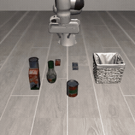
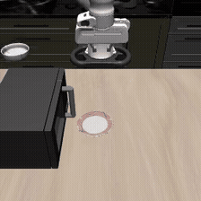
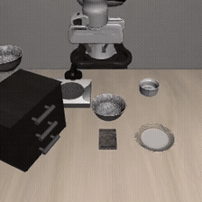
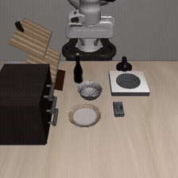

# MCC-FAEA

MCC-FAEA is a demonstration-free robotic manipulation reproduction of **FAEA** (Frontier Agent as Embodied Agent, arXiv:2601.20334) that replaces the paper's Claude Agent SDK + Opus 4.5 stack with **MiniClaudeCode (MCC)** — a self-built terminal coding agent — driving free-tier Chinese LLM endpoints (SenseNova `sensenova-6.8-flash-lite`, Agnes `agnes-3.0-flash`). Each LIBERO task is one independent MCC subprocess session: the agent reads provisioned API docs, writes an `episode.py` that drives a Franka Panda through absolute end-effector Cartesian control under privileged state observation, and iterates through a ReAct loop (write → execute → observe → refine) until the task's native success predicate fires or its trial budget is exhausted. Every "success" is independently re-verified by replaying `episode.py` in a clean sandbox, and every session trace is scanned for reward hacking (counter tampering, API bypass, grid search). On the full LIBERO-120 benchmark the pipeline reaches **20.8% pilot success (25/120)** against the paper's 70.6% — with the difficulty gradient across suites (Object 60% > Spatial 20% ≈ Long 19% > Goal 0%), the resource-vs-difficulty scaling, and even per-suite turn counts closely mirroring the paper, isolating model tier as the dominant gap while confirming that the agent-as-manipulator paradigm transfers across agent frameworks.

## Results snapshot (Pilot, 10-trial cap, 120 tasks)

| Suite | This repro | Paper (Opus 4.5) |
|---|---|---|
| LIBERO-Spatial (10) | 20.0% | 70.0% |
| LIBERO-Object (10) | 60.0% | 100.0% |
| LIBERO-Goal (10) | 0.0% | 60.0% |
| LIBERO-Long (90) | 19.3% | 68.9% |
| **Average** | **20.8%** | **70.6%** |

## 🎬 Demo videos — what MCC received, what it did, and which components fired

Recorded at 256×256 / 20 fps inside the simulation (inline GIFs at 8 fps; full mp4 linked under each). All control code below was
written by MCC itself — `episode.py` issues absolute end-effector pose targets
through the documented wrapper API.

**What every session receives.** One FAEA prompt (paper Fig.1 template + the
official LIBERO task description + a frozen task-0 success script as few-shot)
passed via `--task`, plus a sandbox workspace: `README.md` (task assignment,
the fixed libero-interpreter path, required outputs), `docs/api.md` (the full
wrapper contract), and `.sim_state.json` (trial counter, optionally capped).
MCC then wraps this into a per-turn system message: environment facts + an AST
repo map of the workspace + the 9-tool spec + planning/self-debugging norms +
the live TodoList. Every turn is one ReAct cycle: model proposes tool calls →
permission gate (path lock, destructive-command denial) → tools execute → all
results return packed as a single user message.

**The MCC components doing the work below:** `agent/loop.py` (Ask→Act→Observe
cycle with per-turn stop-losses: MAX_TURNS, cumulative token budget, 3-strike
stall detector), `write_todos` (plan checklist replayed into every system
message), `bash`/`write_file`/`edit_file`/`read_file` (66%/23%/6% of all 7,611
tool calls), the **context-compaction ladder** (auto-summarizes history when
the estimated context crosses TOKEN_BUDGET — what keeps 65–86-turn sessions
alive on a 256K-context flash model), and the JSONL **trace** (our metrics
source — which one session even read back to audit itself).

---

### 1. LIBERO-Object task 0 — success in a single try (14 turns, 1 try)



*(mp4: [results-sample/p1_pilot/libero_object_0/video.mp4](results-sample/p1_pilot/libero_object_0/video.mp4))*

- **Received:** "pick up the alphabet soup and place it in the basket" + a
  few-shot example that happens to BE the solution to this exact task (the
  frozen task-0 script from prompt development).
- **How it went:** turns 1–3 listed the workspace, read the example, and
  copied it straight to `episode.py` — then hit the session's only real
  obstacle: bare `python3` has no sim package. Turns 4–7 located the correct
  conda interpreter (`envs/libero/bin/python`) and validated the wrapper
  import; turns 8–11 re-read the contract and confirmed the trial counter;
  turn 12 ran the episode to success; turn 13 self-audited `meta.json` and
  the recorded video before finishing.
- **Components fired:** read-before-act discipline (`read_file`), permission
  gate 13× (all allowed), no compaction, no todos needed — the cheap path.

### 2. LIBERO-Long #36 — fastest long-horizon success (23 turns, 5 tries, 9.4 min)



*(mp4: [results-sample/p1_pilot/libero_90_36/video.mp4](results-sample/p1_pilot/libero_90_36/video.mp4))*

**What MCC received** — the exact package, identical shape for every task:

- One task line inside `prompt.txt`: *"put the white bowl on the plate"*
  (`libero_90_36`, LIBERO-90/Long suite). That is all the task information —
  no object poses, no scene description, no demonstrations.
- `README.md` (2.1 KB) — workspace contract: what to produce, where the
  trial counter lives, how success is judged.
- `docs/api.md` (6.3 KB) — the `LiberoEnv` interface: 7-dim action
  `[x, y, z, axis-angle×3, gripper]` with `+1`=open / `-1`=close, absolute
  Cartesian targets, `get_obs()` schema (incl. per-object ground-truth
  poses), `check_success()`.
- `example_episode.py` (3 KB) — the frozen task-0 solution, shipped as a
  *skeleton to adapt*, not an answer to this task.
- Output contract: `meta.json` + `episode.py` + `video.mp4`.
- Session config: `sensenova-6.8-flash-lite`, MAX_TURNS=100, 6M token
  budget, ~4.2K-token system prompt; tools: `bash`, `read_file`,
  `write_file`, `edit_file`, `write_todos`, `find_files`, `search_text`,
  `run_tests`.

**How it went, turn by turn** (25 tool calls, all 25 permission checks allowed):

| Turns | What happened |
|---|---|
| 1–4 | Recon: `ls workspace/`; read `README.md`, `example_episode.py`, `docs/api.md`; checked the trial counter `.sim_state.json`; confirmed the task id exists via `list_tasks()` |
| 5–7 | One-liner probes through `LiberoEnv`: opened the env once and read ground-truth poses of `white_bowl_1_main` and `plate_1_main` straight out of `get_obs()` |
| 6, 8 | `write_todos` ×2: *probe environment → write episode.py with pick-up-and-place strategy → run and iterate until success* |
| 9–10 | Wrote `episode.py` v1 (top-down grasp → lift → translate → lower → release) and ran it — `success: False` |
| 11 | Re-ran a tweaked variant inline — tool call errored on a typo'd interpreter path (`minif forge3`), no information gained |
| 12–15 | Wrote a separate `debug.py` probe that executes **only** the grasp→lift→place pipeline phase by phase, printing the object pose after each step; ran it, revised it, ran again — isolated the phase that lost the bowl |
| 16–17 | `write_todos` ×3 (writing done, iterate in progress); checked `.sim_state.json` to budget remaining tries before spending one |
| 18–20 | Rewrote `episode.py` v2 with the fix — the final script re-reads the bowl's true pose **after** the gripper closes (a grasp can drag the object) before planning the lift, and lets the scene settle 10 steps before reading poses; ran to success |
| 21–23 | Verified artifacts (`ls`, `cat meta.json` → `{"success": true, "num_tries": 1}`), deleted `debug.py` to leave a clean workspace, reported |

**Numbers:** 23 turns; 5 simulator tries; 9.4 min wall time; 309.9K tokens
in / 10.3K out; tool mix bash×15, read_file×3, write_file×4, write_todos×3.

**Components fired:** the `write_todos` planner (3 updates tracking
probe → write → iterate), hypothesis-driven self-debug loop (write probe →
run → read → revise — the same loop that becomes a 7-probe ladder in
Spatial #3 below), trial-counter awareness (checked `.sim_state.json`
before spending tries), and tool cleanup discipline. No context compaction
needed at this depth.

### 3. LIBERO-Spatial #3 — trial-and-error success (65 turns, 6 tries)



*(mp4: [results-sample/p1_pilot/libero_spatial_3/video.mp4](results-sample/p1_pilot/libero_spatial_3/video.mp4))*

- **Received:** a spatial-reasoning task where the target's location must be
  inferred from scene layout — the suite where this model mostly fails.
- **How it went:** the grind profile. Turns 1–4 recon; turns 7–25 the
  **debug-ladder**: seven successive `debug1.py`…`debug7.py` probes, each
  isolating one geometric hypothesis (grasp height, approach side, gripper
  timing); turn 26 folded the winning configuration into `episode.py`; turns
  27–35 ran repeated tries, hitting trial-cap pressure; turns 36–55 then did
  something remarkable — the agent **read its own `trace.jsonl` and per-try
  videos to audit which attempt had gotten closest**, cross-checking
  `sim_state.json` counts; turns 49/57–63 re-read the contract and episode,
  edited, and locked in the verified success.
- **Components fired:** the **context-compaction ladder fired 17×** (this
  session could not have fit a 256K window otherwise); stall detector stayed
  quiet because each probe differed; `edit_file` surgical fix at turn 49.

### 4. LIBERO-Goal #0 — honest failure (86 turns, 10-try cap exhausted)



*(mp4: [results-sample/p1_pilot/libero_goal_0/video.mp4](results-sample/p1_pilot/libero_goal_0/video.mp4))*

- **Received:** "open the middle drawer of the cabinet" — an articulated-
  object task. The wrapper exposes no handle joint in `get_obs()`, and the
  model never recovered from that gap.
- **How it went:** research-spiral profile. Turns 4–13 probed the scene and
  wrote `explore.py`; turns 14–23 went deep into LIBERO internals via `bash`
  — reading the task's BDDL definition and the wooden-cabinet MJCF asset to
  find the handle site; turns 24–27, 45, 57, 63, 79–80 even grepped the
  machine for **an unrelated prior robot project's logs** on this exact task
  (found on disk, mined for hints); turns 28–77 cycled through eleven
  `explore.py` rewrites trying to approximate a drawer-grasp blind; turn 78
  finally wrote `episode.py` — too late to do more than burn the remaining
  tries; turn 85 wrote `meta.json` reporting failure honestly, and turn 84
  had already cleaned up its probe files.
- **Components fired:** **context-compaction ladder fired 24×** (86 turns on
  a small window); `search_text` used once the agent noticed raw `grep` was
  slow; the permission gate rejected nothing — the failure is purely
  capability (articulated joint not in the privileged obs, not a model the
  flash tier could probe its way around).

---

Curated evidence lives in [`results-sample/`](results-sample/README.md) (success/failure/cheating case studies with full traces and videos) and [`reports/`](reports/) (stage reports with paper-comparison tables).

## 📁 1. Repository Structure

```
FAEA/
├── SPEC.md                  # full spec: decision records D01–D16, deviation registry V1–V12,
│                            # experimental protocol, failure taxonomy, acceptance gates
├── config.json              # runtime config: per-stage max_turns / trial caps, token budgets,
│                            # video params, env paths, model mapping per provider
├── secrets.local.json       # (gitignored) LLM providers: base_url + api_key + active index
├── runner.py                # orchestrator: workspace prep → MCC subprocess → artifact collection
│                            # → outcome classification → inline verification → provider rotation
├── review.py                # standalone re-verification + suspicious-trace rescan for a stage
├── report.py                # paper Table I / Table V isomorphic tables + per-task CSV
├── rotate_key.py            # manual provider switch (rewrites the LLM_* lines in MCC .env)
├── smoke_m0_libero.py       # M0 acceptance: 120-task enumeration, absolute control, video, trial cap
├── sim/
│   ├── libero_env.py        # the ONLY simulation entry for agents: LiberoEnv with documented
│   │                        # API (reset/step/get_obs/check_success/save_video), absolute
│   │                        # OSC world-frame control, tamper-resistant try counter,
│   │                        # privileged state obs, per-try EGL video recording
│   └── install_libero_env.sh# registers sim/ into the libero conda env via .pth
├── template/                # agent-facing workspace contract
│   ├── README.md            # entry point: task assignment, interpreter path, required outputs
│   ├── docs/api.md          # full wrapper API: action semantics, obs schema, do-not list
│   ├── docs/gymnasium.md    # standard-interface summary
│   └── example_episode.py   # frozen task-0 success script, injected as few-shot into every prompt
├── envs/                    # locked conda env specs (libero py3.10 + robosuite 1.4.0 + mujoco 2.3.3)
├── tasks.json               # cached 120-task enumeration (regenerable via --refresh-tasks)
├── results/                 # (gitignored) raw per-task artifacts: workspace/, trace, videos
├── results-sample/          # curated evidence: 6 case studies incl. an R5 reward-hacking trace
└── reports/                 # generated stage reports (summary.md + tasks.csv)
```

External dependency: [MiniClaudeCode](https://github.com/magickkdd/MiniClaudeCode) at `/home/czx/MiniClaudeCode` — used strictly unmodified; all runtime knobs (`MAX_TURNS`, `MAX_TOTAL_TOKENS`, `TRACE_PATH`, `LLM_*`) are injected by the runner as environment variables.

## ⚙️ 2. Environment Setup

Tested on Ubuntu with RTX 3050 (4GB), 8 cores, miniforge. Python split is forced by a dependency conflict: LIBERO's legacy chain (robosuite 1.4.0, mujoco 2.3.3, numpy 1.22.4) wants ≤3.10, MCC wants ≥3.11 (`StrEnum`).

```bash
# Env 1: simulation (LIBERO official repo, pinned legacy chain)
conda create -n libero python=3.10 -y
conda run -n libero pip install numpy==1.22.4 mujoco==2.3.3 robosuite==1.4.0 \
    bddl==1.0.1 gym==0.25.2 easydict==1.9 hydra-core==1.2.0 cloudpickle==2.1.0 \
    future==0.18.2 scipy==1.10.1 matplotlib==3.7.5 "opencv-python==4.8.1.78" \
    "opencv-python-headless==4.8.1.78" imageio imageio-ffmpeg termcolor
conda run -n libero pip install --no-deps -e /home/czx/LIBERO        # official repo
conda run -n libero pip install torch --index-url https://download.pytorch.org/whl/cpu
echo "/home/czx/LIBERO" > $(conda run -n libero python -c "import site; print(site.getsitepackages()[0])")/libero_repo.pth
echo "/home/czx/FAEA"   > $(conda run -n libero python -c "import site; print(site.getsitepackages()[0])")/faea.pth

# Env 2: agent
conda create -n mcc python=3.11 -y
conda run -n mcc pip install -e /home/czx/MiniClaudeCode
```

Key points:

- LIBERO config paths are isolated via `LIBERO_CONFIG_PATH=/home/czx/.libero-faea` (set as a default inside `sim/libero_env.py`), so a pre-existing global `~/.libero/config.yaml` (e.g. from a LIBERO-PRO install) is never touched.
- `torch.load` needs `weights_only=False` for LIBERO's legacy `.pruned_init` files — handled inside the wrapper (source is the official repo, trusted).
- Rendering is EGL offscreen (`MUJOCO_GL=egl`); OSMesa works as fallback. 256×256 @ 20fps per-try videos are recorded automatically.
- The deprecated `find_packages()`-based editable install of LIBERO silently produces an empty package mapping on modern setuptools — the `.pth` file above is the reliable route.

LLM endpoints live in `secrets.local.json` (gitignored): two OpenAI-compatible providers with the active index; `config.json` maps each provider to its model. The runner injects `LLM_BASE_URL / LLM_API_KEY / LLM_MODEL` into every MCC subprocess — no `.env` file involved. Rotate providers manually with `python3 rotate_key.py [sensenova|agnes]`, or let the runner auto-rotate on `llm_failure` (up to 2 rotations with 60s cooldown; MCC itself retries 429/5xx with backoff).

## 🚀 3. Running the pipeline

```bash
# M0 smoke: env enumeration (10/10/10/90 assertion), absolute-control rollout, video, trial cap
conda run -n libero python smoke_m0_libero.py

# P0 prompt development: solve task 0, freeze its episode.py as the few-shot example
python3 runner.py --stage p0_prompt_dev --task libero_object_0

# P1 pilot: 10-task layered sample, then all 120 (trial_cap=10, parallel sessions)
python3 runner.py --stage p1_pilot --sample 10 --parallel 2
python3 runner.py --stage p1_pilot --all --parallel 2

# P2/P3 retry conditions on the p1 failure set (no trial cap)
python3 runner.py --stage p2_baseline_retry --parallel 2   # same prompt as pilot
python3 runner.py --stage p3_coaching_retry --parallel 2   # + paper's five coaching tips

# Post-hoc: re-verify all successes in a stage, then regenerate reports
python3 review.py --stage p1_pilot
python3 report.py --compare-paper
```

Per-task artifacts land in `results/<stage>/<task_id>/`: `prompt.txt`, `trace.jsonl` (full MCC session), `workspace/` (agent sandbox with `episode.py`, `meta.json`, per-try videos), `video.mp4` (the successful attempt), `verify/` (clean-room replay), `run.json` (outcome, turns, tries, tokens, tool-call histogram, flags). The runner is idempotent — existing `run.json` files are skipped, so interrupted stages resume safely.

## 🔍 4. Honest-accounting machinery

Success is never taken from the agent's word. The gate chain is: LIBERO's native `_check_success` → agent-written `meta.json` → clean-room replay of `episode.py` (must reproduce success) → suspicious-pattern scan → final outcome. Scan rules: R1 API bypass (raw mujoco/robosuite access), R2 exhaustive pose search, R3 success forging, R4 hardcoded-coordinate hints, R5 trial-counter tampering — R5 exists because a flash-tier agent was caught red-handed running `rm sim_state.json` to escape the 10-trial cap (see [`results-sample/p1_pilot/libero_goal_5`](results-sample/README.md); three more zeroed-counter cases were caught in the 90-task suite). The try counter itself lives outside the agent's writable sandbox and is enforced by the wrapper raising `TrialCapExceeded` on the 11th `reset()`.

All deviations from the paper's setup are registered in `SPEC.md` §5.7 (agent framework, model tier, WebFetch→local docs, hard budget ceilings instead of "no limit", post-hoc tamper rules, added replay verification) — nothing is silently relaxed.

## 🙏 Acknowledgement

- [FAEA](https://arxiv.org/abs/2601.20334) — the paper being reproduced (Tsui, Fang, Hwu).
- [LIBERO](https://github.com/lifelong-robot-learning/LIBERO) — benchmark (robosuite 1.4.0 stack).
- [MiniClaudeCode](https://github.com/magickkdd/MiniClaudeCode) — the unmodified agent runtime.
- SenseNova Token Plan & Agnes AI — free-tier inference.

## 📚 Citation

```bibtex
@article{faea2026,
  title={Demonstration-Free Robotic Control via LLM Agents},
  author={Tsui, Brian Y. and Fang, Alan Y. and Hwu, Tiffany J.},
  journal={arXiv preprint arXiv:2601.20334},
  year={2026}
}
```
